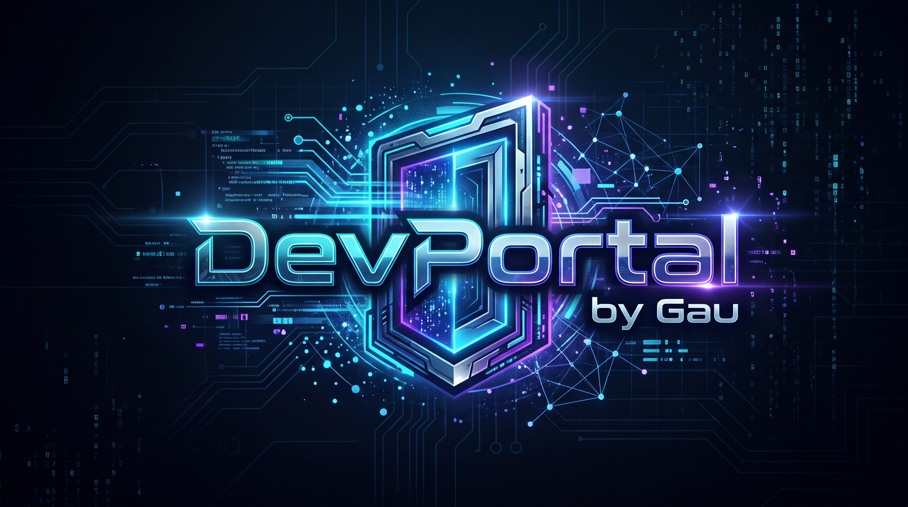

# DevPortal

A dev portal for writing, running, and visualizing code. Playgrounds for JavaScript, TypeScript, Python, Rust and Terraform, switched from the header.

## Playground

Open `index.html` in any browser (no build step, no dependencies).

**Editor**
- Line numbers, Tab indent, auto-indent (after `:` in Python, `{` in JavaScript), `Ctrl/⌘ + Enter` to run, optional auto-run
- **Import** a `.js` or `.py` file (button or drag-and-drop; the language switches automatically), **Save** to a file, or **Copy** to the clipboard
- Editable file name; your code, file name and theme are remembered in the browser

**Preview**
- Runs in a sandboxed iframe with a ready-made `<canvas id="canvas">` and `
`
- Console tab captures `console.*`, uncaught errors (with line numbers) and promise rejections
- A `THEME` object (`bg, fg, muted, accent, accent2, ok, warn, err, fade(alpha)`) follows the selected theme

**Examples**
- Basics: console, async & errors
- Canvas & animation: bouncing balls, sine waves, particle trail, bubble-sort visualizer
- Data, maps & flow: traffic-flow nodes & roads (click to close intersections), world map with live connections, live trend chart, bar race
- UI & media: interactive counter, video embedder (YouTube / Vimeo / .mp4)

**Themes**: Black, Dark, Light, Neon · Matrix (digital rain), Neon · Jarvis (HUD rings & grid), Heaven (gold, glass panels, light rays and sparkles). Animated backgrounds respect `prefers-reduced-motion`.

## Python
Python runs in your browser using [Pyodide](https://pyodide.org) (CPython compiled to WebAssembly), inside the same sandboxed preview.
- `print()` and errors (with a clean traceback) go to the Console tab; the runtime loads once (~10 MB, then cached by the browser) and stays warm between runs
- Packages load automatically on import (numpy, pandas, matplotlib, scipy, ...). `micropip` works for pure-Python packages
- `show_html(html)` puts HTML on the page, `canvas` is a ready-made canvas (draw on it through the JS bridge), and `THEME` follows the portal theme
- matplotlib figures render into the preview and pick up the theme colours
- Examples: hello, algorithms & timing, errors, canvas particles, matplotlib trend / scatter / Mandelbrot, pandas summary
- `input()` isn't available; Stop discards the runtime (the next run reloads it from cache)

## TypeScript & Rust
- **TypeScript** is compiled in the browser with the TypeScript compiler (loaded from a CDN on first use), then run in the same sandboxed preview as JavaScript, so canvas/`THEME`/DOM examples work. It transpiles only: syntax errors are reported with line numbers, but types aren't checked.
- **Rust** is compiled and run on the official [Rust Playground](https://play.rust-lang.org) — your code is sent there, so it needs internet access (it won't work inside the claude.ai artifact viewer). stdout shows in the preview and Console; compiler errors and warnings show in the Console.
- Every language has a **✦ New (blank)** example and a **Clear** button (before Reset) that empties the editor, console and preview.
- Each language also has its own reference tab: MDN, TS Docs, Python Docs, Rust Docs, Terraform Registry.

## Terraform (simulator)
A mock IaC experience — **no real cloud calls, nothing is created anywhere**. Write real HCL on the left; the preview is a live infrastructure diagram.
- Command bar: `init`, `validate`, `plan`, `apply`, `destroy`, `state list`, `output`, plus pause/resume, a simulation speed control and *reset state*. **▶ Run** = init → plan → apply.
- The diagram forms as Terraform executes: nodes appear from your config (dashed = planned), dependency edges draw in, nodes pulse while *Creating…*, then turn green with a ✓. Updates, replacements, destroys and failures each get their own animation. Click a node to inspect its attributes.
- The Console tab shows real-format Terraform output: plan diffs (`+ ~ - -/+`, *(known after apply)*, `# forces replacement`), `Creating… / Still creating… [10s elapsed] / Creation complete after 3s [id=…]`, `Apply complete! Resources: …`, outputs, and `╷ Error:` diagnostics with the offending line. A short log tail is also shown under the diagram.
- State persists between applies (browser localStorage), so editing and re-applying gives real in-place updates, replacements and drift-free no-ops. Parallelism is 10, in simulated time.
- Supports `resource`/`data`/`variable`/`locals`/`output`, `count`, `for_each`, `depends_on`, splats, `for` expressions, conditionals, templates, heredocs and ~60 built-in functions. Mock schemas cover common AWS, Azure and GCP resources plus random/null/local; unknown resource types still work with generic behaviour. Modules and provisioners aren't supported.
- **Registry** tab (next to Console) embeds registry.terraform.io with quick links. If the site or the page hosting the portal blocks framing it stays blank — use *Open in new tab*.
- Examples: VPC + EC2, three-tier web app, serverless API, S3 data lake, RDS, Azure, GCP, an apply-time failure and a config-error showcase.

## Notes
- Code runs in `iframe sandbox="allow-scripts allow-popups"`, isolated from the page.
- The video embedder and the Python runtime need internet access and a normal browser context (local file or GitHub Pages); Pyodide loads from `cdn.jsdelivr.net`.
